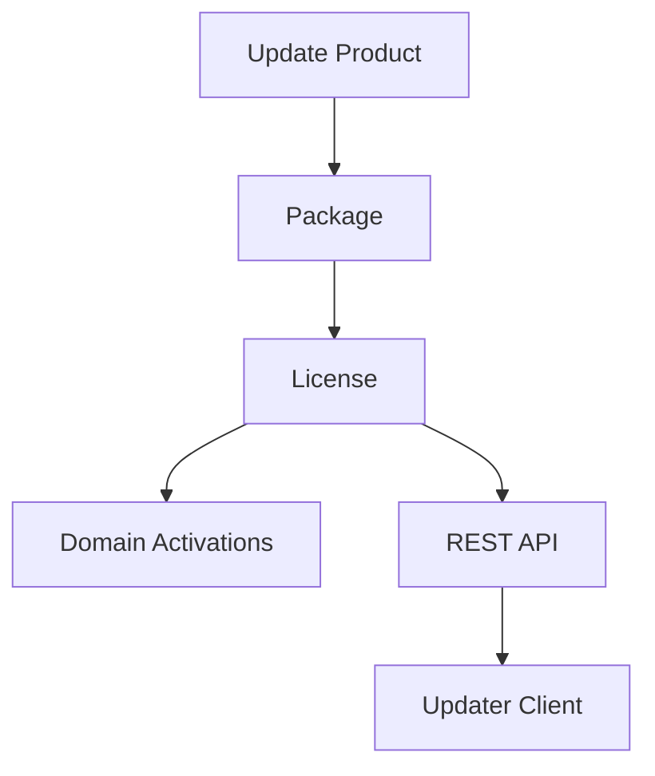
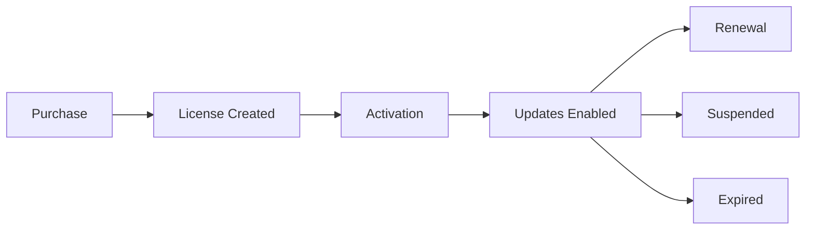

# UUPD Server

> A self-hosted WordPress licensing and update server for Universal Updater.

UUPD Server allows plugin, theme and software developers to distribute updates, manage licenses, track activations and integrate with WooCommerce, Easy Digital Downloads, Stripe and custom platforms — all from their own WordPress installation.

## Features

### Update Management

- Custom Update post type
- Multiple downloadable packages per product
- Multiple file support
- Changelog management
- Version management
- WordPress and PHP version requirements
- Icons and banners for update metadata
- Remote download URL support

### Licensing

- License key generation
- License prefixes per product
- Package-based licensing
- Activation limits
- Domain activation tracking
- Expiry dates
- Lifetime licenses
- License suspension
- License status management
- User-linked licenses
- Order reference support

### REST API

- License validation
- Activation management
- License creation
- License updates
- License suspension
- Bearer token authentication

### Integrations

- WooCommerce
- Easy Digital Downloads
- Stripe
- Paddle
- LemonSqueezy
- SureCart
- Custom applications

## Architecture

## License Lifecycle

## REST API

Public:
- POST /license/check
- POST /license/activate
- POST /license/deactivate

Protected:
- POST /license
- POST /license/update
- POST /license/suspend

## Helper Functions

- uupd_create_license()
- uupd_update_license()
- uupd_suspend_license()
- uupd_deactivate_license_for_domain()
- uupd_get_license_by_key()

## License

GPL-2.0-or-later
