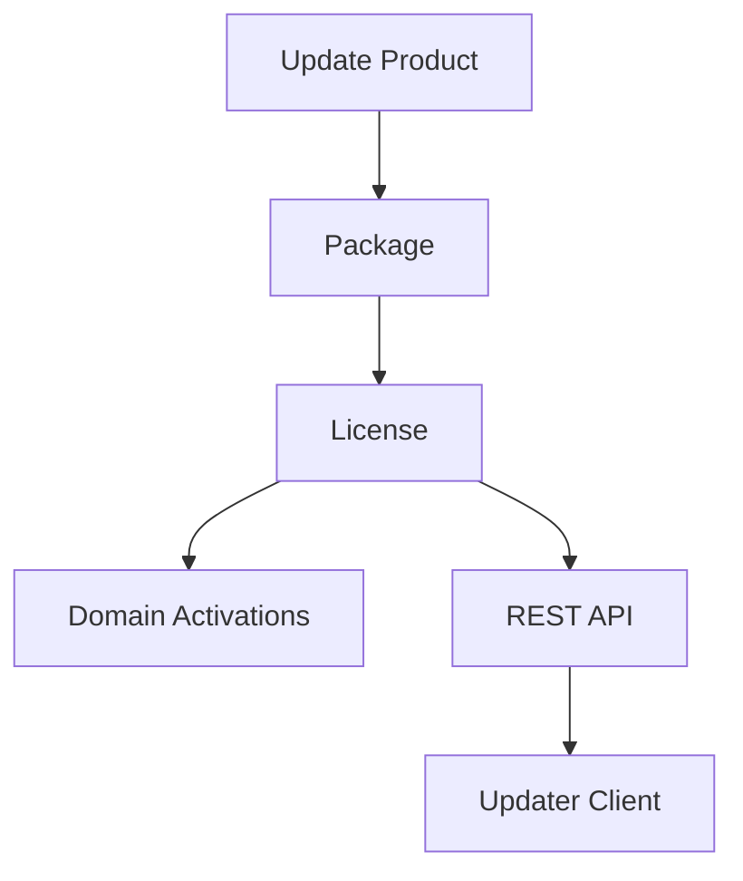
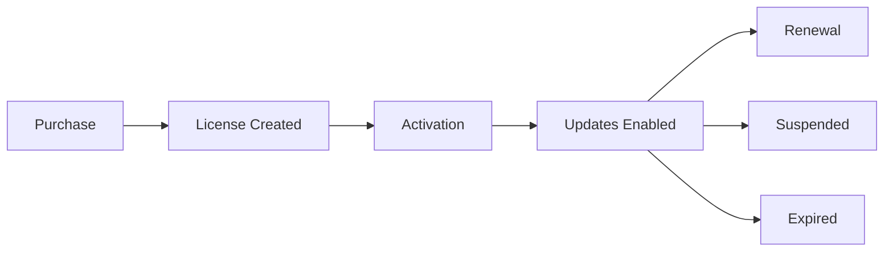

# UUPD Server

> A self-hosted WordPress licensing and update server for Universal Updater.

UUPD Server allows plugin, theme and software developers to distribute updates, manage licenses, track activations and integrate with WooCommerce, Easy Digital Downloads, Stripe and custom platforms — all from their own WordPress installation.

**Current development version:** 2.2.0

## Features

### Update Management

- Custom Update post type
- Multiple downloadable packages per product
- Multiple file support
- Changelog management
- Version management
- WordPress and PHP version requirements
- Icons and banners for update metadata
- Remote download URL support

### Licensing

- License key generation
- License prefixes per product
- Package-based licensing
- Activation limits
- Domain activation tracking
- Expiry dates
- Lifetime licenses
- License suspension
- License status management
- User-linked licenses
- Order reference support
- Customer key rotation, with site-wide and per-licence permission settings
- Master and child licences with shared activation allowances, child activation caps and purpose notes
- Per-child revocation, deletion and connected-site disconnection
- Configurable maximum child keys (automatic or manually capped)
- Optional private licence interaction history (latest 20 events)
- Admin licence list filters by username, order/invoice reference, expiry range and download

### REST API

- License validation
- Activation management
- License creation
- License updates
- License suspension
- Bearer token authentication

### Integrations

- WooCommerce
- Easy Digital Downloads
- Stripe
- Paddle
- LemonSqueezy
- SureCart
- Custom applications

## Key management (2.2.0)

Administrators can rotate a licence key and manage subordinate child keys from the licence editor. Customers who own a licence can manage its keys using the **UUPD Licence Keys** block (`uupd/license-keys`), the `[uupd_license_keys]` shortcode, or supported existing account/purchase pages. For one licence use `[uupd_license_keys license_id="123"]` (replace `123` with its post ID).

A rotation replaces the existing key immediately; update any installations still using the old key. Child keys inherit the master licence's entitlement and expiry, have their own activation cap and optional purpose note, and share the master's total activation allowance. Suspending or expiring a master makes its children unusable. Disconnecting a child key from a site invalidates that site's domain-specific checks until reactivated; a key-only check cannot identify a disconnected site.

**Defaults:** Customer rotation is enabled; customer child-key creation and private interaction logging are disabled. Administrators can manage keys even when customer permissions are disabled, subject to licence and child-count limits. Child count defaults to the master's activation limit, or unlimited for an unlimited master. Revoked children still count towards the child limit until deleted.

Configure defaults in **Settings → UUPD Server**, or override customer permissions and child-key limits in an individual licence editor. Turning off child creation normally revokes children which inherit that permission and releases their activations; choose **Keep existing child keys active** if needed. Consider that change before saving.

The interaction-history option stores up to 20 filtered events per licence, without keys, domains or full request payloads. Integrations can record permitted events with `uupd_record_license_interaction( $license_id, $event, $details )` when logging is enabled.

Further guidance:

- [Defaults and settings](docs/01-settings-and-defaults.md)
- [Admin key management](docs/02-admin-key-management.md)
- [Customer key management](docs/03-customer-key-management.md)
- [Changelog](CHANGELOG.md)

## Architecture

## License Lifecycle

## REST API

Public:

- POST /license/check
- POST /license/activate
- POST /license/deactivate

Protected:

- POST /license
- POST /license/update
- POST /license/suspend

## Helper Functions

- uupd_create_license()
- uupd_update_license()
- uupd_suspend_license()
- uupd_deactivate_license_for_domain()
- uupd_get_license_by_key()

## License

GPL-2.0-or-later

## Automated release publishing

Version 2.1.0 introduced `POST /wp-json/uupd/v1/products/{slug}/release` for publishing releases directly to native UUPD Update posts. See [RELEASE-API.md](docs/RELEASE-API.md) for authentication, fields, deployment script configuration, append/replace semantics, and storage-security limitations.
